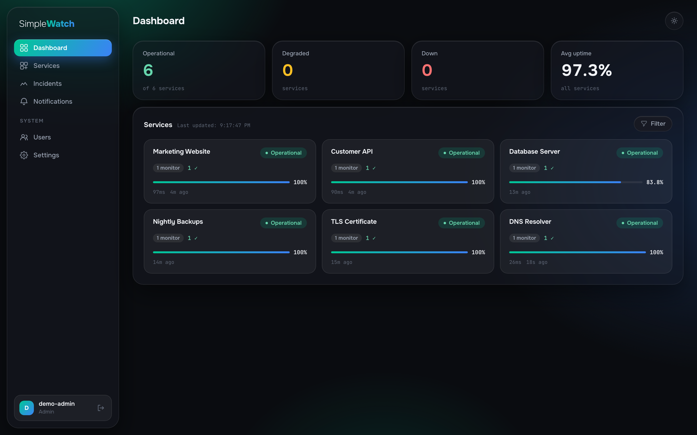
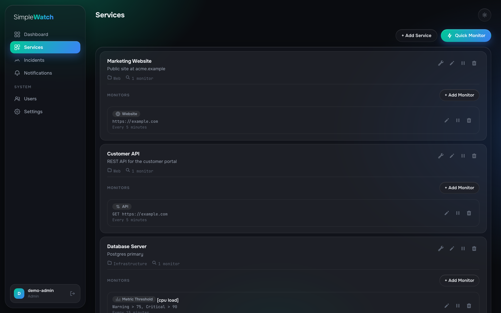
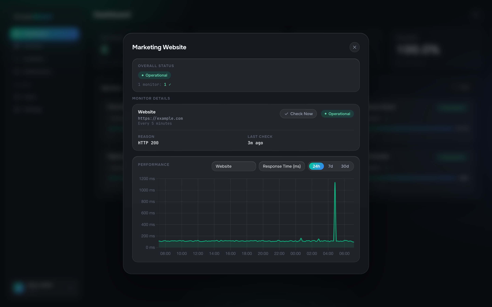
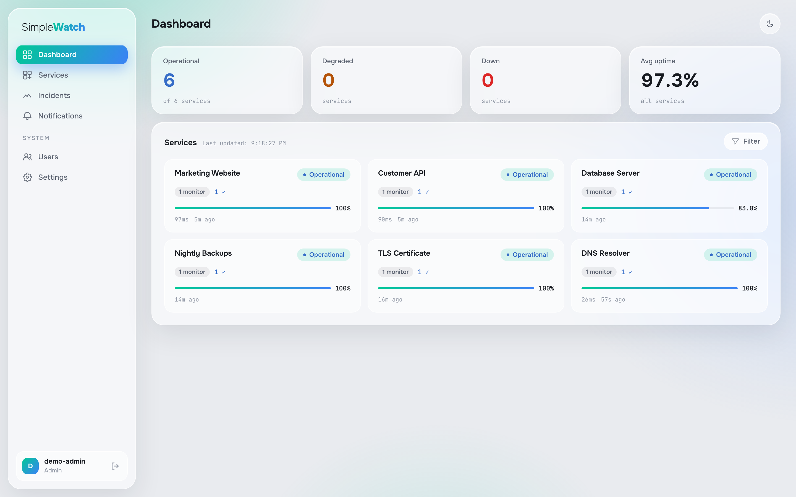
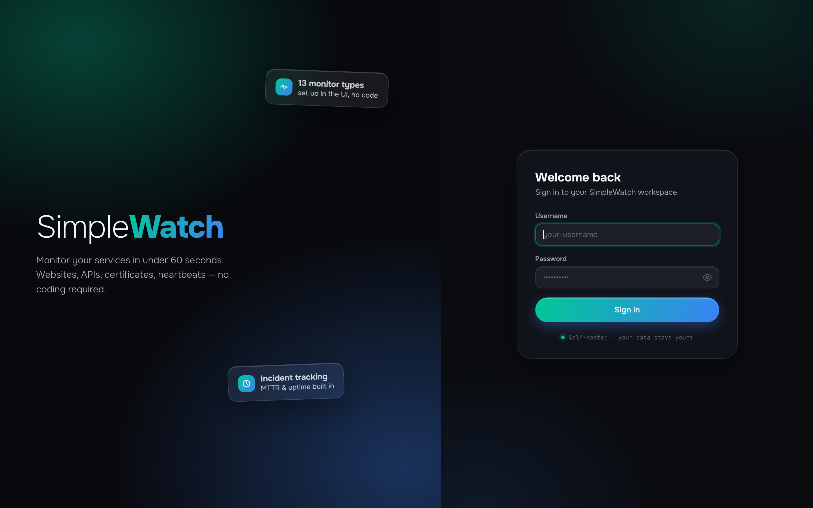

# Simple**Watch**

Uptime monitoring without the observability stack. Know when a website, API, server
or cron job breaks — and when it recovers — deployed with one command.

Part of a suite of simple, self-hosted ops tools: each app does one thing well,
runs from a single `docker compose up`, and needs zero configuration to start.



## What it does

- **13 monitor types, zero code** — website, API, port, ping, DNS, SSL certificate,
  deadman/heartbeat, metric threshold, SNMP, SEO, GitHub Actions, local LLM, expiration —
  all configured in the UI in under a minute
- **Services with multiple monitors** — group checks per service; status aggregates
  automatically (operational / degraded / down)
- **Incidents** — opened and resolved automatically on status changes, with MTTR,
  uptime analytics, timelines and CSV export
- **Alerts that stay quiet** — email, Slack, Discord, Teams, Telegram, PagerDuty,
  Opsgenie, Matrix, ntfy.sh or any webhook; cooldowns prevent spam, recovery always notifies
- **Public status page** — opt-in per service, with announcement banner and scheduled
  maintenance windows that suppress alerts
- **AI SRE companion (optional)** — incident analysis, remediation suggestions and
  one-click post-mortems via Ollama, OpenAI or Anthropic; human approval by default
- **SLA tracking** — per-service uptime targets with error budgets
- **Backup & restore** — export and import service configurations as JSON





Dark and light themes, toggled from the top bar — the choice persists per user.





## Quick start

```bash
docker run -d -p 5050:5050 -v simplewatch-data:/data gdelhaes/simplewatch
```

or from source:

```bash
git clone https://github.com/gillesdelhaes/simplewatch.git
cd simplewatch
docker compose up -d
```

Open **http://localhost:5050** — a one-time setup screen creates your admin account
(optionally with sample monitors to explore). No config files, no env vars.

## Push monitoring

Passive monitors accept data from your own scripts and jobs:

```bash
# Report a metric (evaluated against your thresholds)
curl -X POST http://localhost:5050/api/v1/metric/Database%20Server/cpu%20load \
  -H "Content-Type: application/json" \
  -d '{"api_key": "YOUR_API_KEY", "value": 42.5}'

# Heartbeat from a cron job (alerts if it stops arriving)
curl -X POST http://localhost:5050/api/v1/heartbeat/Nightly%20Backups/backup%20job \
  -H "Content-Type: application/json" \
  -d '{"api_key": "YOUR_API_KEY"}'
```

See [API_DOCS.md](API_DOCS.md) for the full API and [USER_GUIDE.md](USER_GUIDE.md)
for monitor setup guides.

## Stack

- **Backend:** Python + FastAPI, SQLite, APScheduler — one process, no broker, no external DB
- **Frontend:** vanilla JavaScript, no build step
- **Deploy:** a single container via Docker Compose, one volume for data

## License

Dual-licensed: free for self-hosted use (even commercial) under
[AGPL-3.0](LICENSE); a [commercial license](LICENSE-COMMERCIAL) is available for
offering SimpleWatch as a service without the AGPL obligations.
